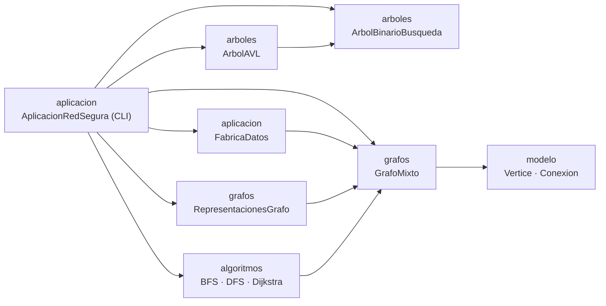

# RedSegura Sincelejo

**Árboles y grafos aplicados a una red de atención de emergencias** — Parcial 2 de Estructura de Datos II (2026).

Aplicación de consola en **Java + Maven** que modela la movilidad entre universidades, centros de salud, nodos de transporte y puntos de encuentro de Sincelejo. Implementa desde cero (sin librerías que resuelvan el algoritmo):

- Árbol binario de búsqueda (**ABB**) y árbol **AVL** con las cuatro rotaciones (LL, RR, LR, RL).
- **Grafo mixto** (aristas no dirigidas y arcos dirigidos), etiquetado y ponderado.
- Tres representaciones: **lista de adyacencia**, **matriz de adyacencia ponderada** y **matriz de incidencia**.
- Recorridos **BFS** (con cola) y **DFS** (recursivo, con detección de ciclos y componentes).
- Ruta mínima con **Dijkstra** (`PriorityQueue`, relajación, predecesores y reconstrucción del camino).

> Los tiempos del grafo son datos didácticos de simulación; no constituyen información oficial de tránsito ni de respuesta a emergencias.

| | |
|---|---|
| **Autor** | Juan Herrera |
| **Docente** | Jaider Enrique Reyes Herazo |
| **Modalidad** | Individual |
| **Tecnología** | Java · Maven · Apache NetBeans · JUnit 5 |

---

## Contenido

1. [Requisitos](#requisitos)
2. [Compilar, probar y ejecutar](#compilar-probar-y-ejecutar)
3. [Estructura del proyecto](#estructura-del-proyecto)
4. [Arquitectura](#arquitectura)
5. [Datos: 12 lugares y 18 conexiones](#datos-12-lugares-y-18-conexiones)
6. [Uso: menú de consola](#uso-menú-de-consola)
7. [Consultas obligatorias Q1–Q7](#consultas-obligatorias-q1q7)
8. [Complejidad](#complejidad)
9. [Pruebas](#pruebas)
10. [Decisiones de diseño](#decisiones-de-diseño)

---

## Requisitos

- **JDK 25** (el `pom.xml` define `maven.compiler.release` en 25). Si usas un JDK anterior, ajusta ese valor en el `pom.xml`.
- **Apache NetBeans** (recomendado) o **Maven 3.8+** por línea de comandos.
- Conexión a internet la primera vez, para descargar JUnit 5 y los plugins de Maven.

```bash
java -version
mvn -version
```

## Compilar, probar y ejecutar

### Desde Apache NetBeans

`File → Open Project`, seleccionar la carpeta del proyecto y pulsar *Run* (F6). La acción *Run* ya está configurada en `nbactions.xml` con la clase principal `aplicacion.AplicacionRedSegura`.

### Desde la terminal

```bash
git clone https://github.com/JuanHerrera28/Parcial-Estructuras-de-datos-II.git
cd Parcial-Estructuras-de-datos-II

mvn clean package        # compila el proyecto y ejecuta las pruebas
mvn test                 # solo pruebas

# ejecutar la aplicación (clase principal: aplicacion.AplicacionRedSegura)
mvn compile exec:java -Dexec.mainClass=aplicacion.AplicacionRedSegura
```

También se puede compilar y ejecutar sin Maven (no hay dependencias en el código principal):

```bash
mkdir out
javac -encoding UTF-8 -d out $(find src/main -name '*.java')
java -cp out aplicacion.AplicacionRedSegura
```

## Estructura del proyecto

```
.
├── pom.xml
├── nbactions.xml
├── README.md
└── src
    ├── main/java/
    │   ├── aplicacion/    AplicacionRedSegura    menú de consola (CLI) y consultas Q1–Q7
    │   │                  FabricaDatos           conjunto de datos del parcial (12 + 18)
    │   ├── modelo/        Vertice, Conexion      modelo de datos con validaciones
    │   ├── arboles/       NodoArbol, ArbolBinarioBusqueda, ArbolAVL
    │   ├── grafos/        GrafoMixto, RepresentacionesGrafo
    │   └── algoritmos/    BusquedaAnchura (BFS), BusquedaProfundidad (DFS), SolucionDijkstra
    └── test/java/pruebas/
                           PruebasArboles, PruebasGrafos
```

## Arquitectura



| Paquete | Responsabilidad |
|---|---|
| `aplicacion` | Menús, lectura de teclado e impresión. Crea el grafo con `FabricaDatos` y mantiene el ABB y el AVL con los mismos vértices. |
| `modelo` | `Vertice` (id, etiqueta, tipo) y `Conexion` (id, origen, destino, dirigida, peso, etiqueta) con validación de campos. |
| `arboles` | `ArbolBinarioBusqueda<T>` y `ArbolAVL<T>` (hereda del ABB y añade altura por nodo y rotaciones). Reciben un comparador (`BiFunction`) en el constructor. |
| `grafos` | `GrafoMixto` guarda vértices, conexiones y la lista de adyacencia; `RepresentacionesGrafo` construye y muestra las tres representaciones. |
| `algoritmos` | `BusquedaAnchura`, `BusquedaProfundidad` y `SolucionDijkstra`: cada uno recibe el `GrafoMixto` por constructor. |

**Orientación:** `GrafoMixto.obtenerVecinos(id)` devuelve las conexiones que se pueden usar saliendo de un vértice. Una conexión dirigida A → B aparece solo en A; una no dirigida A — B aparece en ambos extremos. BFS, DFS y Dijkstra consumen ese método, por lo que respetan la orientación sin repetir lógica.

## Datos: 12 lugares y 18 conexiones

La clase `FabricaDatos` crea el grafo con los datos originales del parcial.

| ID | Lugar | Tipo | | ID | Lugar | Tipo |
|---|---|---|---|---|---|---|
| S01 | UAJS Sede C | Universidad | | S07 | Estación Central SETP | Transporte |
| S02 | UAJS Sede E | Universidad | | S08 | Terminal de Transporte | Transporte |
| S03 | Universidad de Sucre | Universidad | | S09 | Parque Santander | Punto de encuentro |
| S04 | CECAR | Universidad | | S10 | Mercado de Sincelejo | Comercio |
| S05 | Hospital Universitario | Salud | | S11 | PEP Argelia | Paradero |
| S06 | Clínica Las Américas | Salud | | S12 | Glorieta Sincelejito | Movilidad |

| ID | Origen | Destino | Tipo | Min | Etiqueta |
|---|---|---|---|---|---|
| R01 | S01 | S07 | Dirigida | 4 | Corredor universitario |
| R02 | S07 | S01 | Dirigida | 6 | Retorno por vía alterna |
| R03 | S01 | S09 | No dirigida | 5 | Corredor peatonal |
| R04 | S02 | S01 | No dirigida | 8 | Conexión entre sedes |
| R05 | S02 | S06 | Dirigida | 10 | Ruta de atención |
| R06 | S06 | S05 | Dirigida | 4 | Corredor clínico |
| R07 | S05 | S09 | No dirigida | 6 | Vía hospitalaria |
| R08 | S09 | S10 | No dirigida | 3 | Centro histórico |
| R09 | S10 | S08 | Dirigida | 8 | Salida al terminal |
| R10 | S08 | S10 | Dirigida | 9 | Ingreso desde terminal |
| R11 | S03 | S12 | No dirigida | 4 | Corredor Puerta Roja |
| R12 | S12 | S09 | No dirigida | 7 | Troncal al centro |
| R13 | S04 | S11 | No dirigida | 6 | Conexión universitaria |
| R14 | S11 | S07 | Dirigida | 8 | Ruta SETP al centro |
| R15 | S07 | S09 | No dirigida | 3 | Transferencia central |
| R16 | S07 | S08 | Dirigida | 12 | Ruta SETP al terminal |
| R17 | S09 | S03 | Dirigida | 7 | Ruta hacia universidad |
| R18 | S12 | S04 | Dirigida | 9 | Ruta hacia CECAR |

## Uso: menú de consola

```
==========================================
      REDSEGURA - MENU PRINCIPAL
==========================================
1. Gestion del Grafo
2. Gestion de Arboles (ABB y AVL)
3. Representaciones del Grafo
4. Recorridos (BFS y DFS)
5. Ruta Minima (Dijkstra)
6. Consultas Obligatorias (Q1-Q7)
7. Salir
==========================================
```

| Opción | Submenú |
|---|---|
| **1. Gestión del grafo** | Listar vértices y conexiones, insertar y eliminar vértices, insertar y eliminar conexiones, consultar vecinos de un vértice. |
| **2. Gestión de árboles** | Ver ABB y AVL (inOrder, preOrder, postOrder, altura, tamaño), insertar, eliminar y buscar (con conteo de pasos), comparar alturas, demostrar las rotaciones AVL. |
| **3. Representaciones** | Lista de adyacencia, matriz de adyacencia ponderada, matriz de incidencia, o las tres juntas. |
| **4. Recorridos** | BFS, DFS, comparación BFS vs DFS, detección de ciclos dirigidos, componentes. |
| **5. Ruta mínima** | Ruta entre dos vértices, ruta de control S02 → S08, bloquear una conexión y recalcular. |
| **6. Consultas Q1–Q7** | Ejecuta cada consulta obligatoria del parcial. |

Los errores (ID inexistente, duplicado, peso inválido, opción no válida) se muestran como `Error: …` y **el programa continúa**.

**Lectura de las representaciones:**

- *Matriz de adyacencia:* la celda `[i][j]` contiene el peso en minutos de la conexión i → j; `-1` indica que no hay conexión y la diagonal vale `0`. Las aristas no dirigidas llenan ambas celdas simétricas.
- *Matriz de incidencia:* una fila por vértice y una columna por conexión. En un arco dirigido el origen vale `-1` y el destino `1`; en una arista no dirigida ambos extremos valen `1`.

## Consultas obligatorias Q1–Q7

Se ejecutan desde el menú **6**. Resultados obtenidos al ejecutar la aplicación con los datos originales:

| Consulta | Resultado |
|---|---|
| **Q1** Buscar *Hospital Universitario* (S05) en ABB y AVL | ABB: **5** pasos (altura 12) · AVL: **4** pasos (altura 4) |
| **Q2** Cuatro rotaciones AVL | LL `30,20,10` · RR `10,20,30` · LR `30,10,20` · RL `10,30,20` → en los cuatro casos queda balanceado con inOrder `[10, 20, 30]` y altura 2 |
| **Q3** Lista, matriz de adyacencia e incidencia | Tres representaciones con el mismo orden de vértices (S01…S12) y de conexiones (R01…R18) |
| **Q4** BFS y DFS desde S02 | BFS: `S02, S01, S06, S07, S09, S05, S08, S10, S12, S03, S04, S11` · DFS: `S02, S01, S07, S09, S05, S10, S08, S12, S03, S04, S11, S06` |
| **Q5** Dijkstra S02 → S08 | `S02 → S01 → S07 → S08` = **24 min** ✔ (valor de control) |
| **Q6** Bloquear R16 y recalcular | Antes: `S02 → S01 → S07 → S08` = 24 min · Después: `S02 → S01 → S09 → S10 → S08` = **24 min**: el camino cambia, el costo no |
| **Q7** Vértice inexistente | La aplicación muestra `Error: …` y vuelve al menú sin terminar |

**¿Por qué difieren BFS y DFS (Q4)?** BFS usa una cola y visita por niveles: primero todos los vecinos de S02 (S01, S06), luego los de ellos, y así sucesivamente. DFS se hunde por una rama hasta agotarla (S02 → S01 → S07 → S09 → …) y recién después vuelve a lo pendiente (S06 queda de último).

**¿Por qué el costo no cambia en Q6?** Al bloquear R16 (S07 → S08, 12 min) se pierde la ruta `S02-S01-S07-S08` (8 + 4 + 12 = 24), pero existe una alternativa por el centro: `S02-S01-S09-S10-S08` (8 + 5 + 3 + 8 = 24). Empatan en 24 minutos.

> **Nota:** `bloquearConexion` elimina la conexión del grafo. Para recuperar R16 hay que volver a insertarla (menú 1 → 5) o reiniciar la aplicación.

## Complejidad

V = vértices, E = conexiones, n = claves, h = altura del árbol.

| Estructura / algoritmo | Tiempo | Espacio |
|---|---|---|
| ABB insertar / buscar / eliminar | O(h) → O(n) peor caso, O(log n) promedio | O(n) |
| AVL insertar / buscar / eliminar | **O(log n)** garantizado | O(n) |
| Recorridos de árbol (`inOrder`, `preOrder`, `postOrder`) | O(n) | O(n) |
| Lista de adyacencia | O(V + E) | O(V + E) |
| Matriz de adyacencia | O(V² + E) | O(V²) |
| Matriz de incidencia | O(V · E) | O(V · E) |
| BFS | O(V + E) | O(V) |
| DFS | O(V + E) | O(V) |
| Dijkstra (`PriorityQueue`) | O((V + E) log V) | O(V + E) |

**ABB vs AVL con las 12 claves del parcial** (insertadas en orden S01…S12): el ABB degenera en una lista (altura 12) mientras el AVL se mantiene balanceado (altura 4). Por eso buscar S05 cuesta 5 pasos en el ABB y 4 en el AVL, y la diferencia crece con n: con claves ordenadas, el ABB necesita O(n) pasos y el AVL O(log n).

## Pruebas

JUnit 5 — **37 pruebas** en dos clases, en `src/test/java/pruebas/`:

```bash
mvn test                          # todas las pruebas
mvn test -Dtest=PruebasArboles    # una clase
mvn test -Dtest=PruebasGrafos     # la otra clase
```

| Clase | Pruebas | Cubre |
|---|---|---|
| `PruebasArboles` | 13 | ABB (inserción, búsqueda, duplicados, eliminación de existente e inexistente, recorridos), AVL (rotaciones LL/RR/LR/RL, eliminación, duplicados, balance tras varias inserciones) |
| `PruebasGrafos` | 24 | Vértices y conexiones (alta, baja, duplicados, origen inexistente, pesos inválidos), lista y matrices de adyacencia e incidencia, BFS, DFS y Dijkstra (incluyendo vértice inexistente y grafo desconectado), bloqueo de conexión que cambia la ruta |

## Decisiones de diseño

- **Estructuras propias, sin librerías de algoritmos.** AVL, BFS, DFS y Dijkstra están escritos desde cero. De la librería estándar solo se usan contenedores: `LinkedList`, `Queue`, `PriorityQueue` y mapas/conjuntos para la lista de adyacencia y los visitados.
- **`LinkedHashMap` para vértices y conexiones.** Conserva el **orden de inserción**; ese orden es el que comparten las tres representaciones, de modo que la lista y las matrices siempre coinciden.
- **Orientación en un solo lugar.** `GrafoMixto.obtenerVecinos(id)` decide qué conexiones se pueden usar desde un vértice. Las no dirigidas se registran en ambos extremos de la lista de adyacencia; las dirigidas, solo en el origen.
- **Árboles genéricos con comparador.** `ArbolBinarioBusqueda<T>` y `ArbolAVL<T>` reciben un comparador, por lo que sirven tanto para `Vertice` (ordenados por ID) como para enteros en la demostración de rotaciones. `ArbolAVL` extiende al ABB y reutiliza recorridos, búsqueda y conteo de pasos.
- **Validaciones en el modelo y el grafo.** `Vertice` y `Conexion` rechazan campos nulos o vacíos; el grafo rechaza IDs duplicados, extremos inexistentes y pesos inválidos. Todas las validaciones lanzan `IllegalArgumentException`.
- **Un solo punto de captura de errores.** Cada opción de menú se envuelve en `try/catch`, imprime `Error: <mensaje>` y regresa al menú: el programa nunca termina por un dato inválido.
- **Dijkstra sin ruta.** Si el destino es inalcanzable, `ResultadoDijkstra` devuelve camino vacío y distancia `-1`.
- **AVL: balanceo tras insertar y eliminar.** Después de cada operación se actualiza la altura de los nodos del camino y se aplica la rotación LL, RR, LR o RL que corresponda.

## Originalidad

Proyecto individual. El historial de commits refleja el desarrollo progresivo de cada componente (modelo → grafo → representaciones → BFS/DFS → Dijkstra → AVL → integración).
